*หน้าเว็บ [USGS Earthquake Hazards Program](https://earthquake.usgs.gov/) แหล่งข้อมูลแผ่นดินไหวของโปรเจกต์นี้*

# Seismic & Insurance Analytics MCP Server

งานวิชา Natural Language Processing หัวข้อ Agent and MCP Tool Integration (Lab C และ Lab D)

MCP Server สำหรับดึงข้อมูลแผ่นดินไหวจาก USGS และกรมอุตุนิยมวิทยา (TMD) แล้วให้ Agent ใช้ค้นหา วิเคราะห์ และคำนวณ parametric payout ของทรัพย์สินที่เอาประกัน

- Transport: Streamable HTTP
- Runtime: Docker container
- MCP Host: Claude Desktop เชื่อมผ่าน `mcp-remote`
- Endpoint: `http://localhost:8000/mcp`

## สถานะงาน

| งาน | รายการ | ผล |
|---|---|---|
| Lab C | ติดตั้ง Claude Desktop | เสร็จ |
| Lab C | ติดตั้ง Filesystem และกำหนด allowed directory | เสร็จ |
| Lab D | ดึงข้อมูลจาก USGS และ TMD | เสร็จ |
| Lab D | Tool วิเคราะห์และคำนวณ payout | เสร็จ |
| Lab D | Transport แบบ Streamable HTTP | เสร็จ |
| Lab D | รันบน Docker | เสร็จ |
| Lab D | เชื่อม Claude Desktop กับ MCP Server | เสร็จ |

## Flow การทำงาน

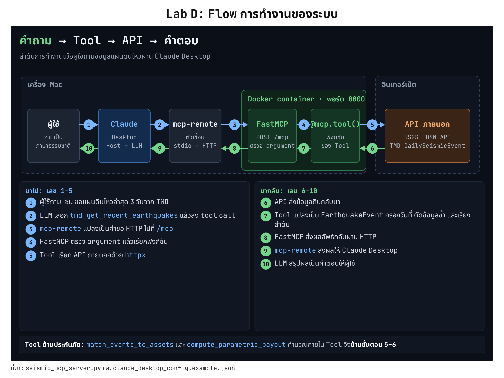

## โครงสร้างโปรเจกต์

```text
.
├── seismic_mcp_server.py                MCP Server และ Tool ทั้ง 5 ตัว
├── test_server.py                       Unit test
├── requirements.txt                     Python dependencies
├── Dockerfile                           ไฟล์ build Docker image
├── claude_desktop_config.example.json   ตัวอย่าง config ของ Claude Desktop
└── docs/
    ├── images/                          ภาพผลการทดสอบ
    └── teaching/                        ภาพสื่อการสอน
```

## Tools

| Tool | หน้าที่ |
|---|---|
| `usgs_search_earthquakes` | ค้นหาแผ่นดินไหวจาก USGS |
| `tmd_get_daily_earthquakes` | ดึงข้อมูลรายวันจาก TMD |
| `tmd_get_recent_earthquakes` | ดึงข้อมูลย้อนหลัง 1–7 วันจาก TMD |
| `match_events_to_assets` | จับคู่แผ่นดินไหวกับทรัพย์สินตามระยะทางและขนาด |
| `compute_parametric_payout` | คำนวณ parametric payout |

ค่าเริ่มต้นของ payout: ไม่เกิน 50 กม. จ่าย 50%, ไม่เกิน 100 กม. จ่าย 25%, ไม่เกิน 200 กม. จ่าย 10% และแผ่นดินไหวต้องมีขนาดอย่างน้อย 5.0

## วิธีติดตั้งและรัน

สิ่งที่ต้องมี: Docker Desktop, Claude Desktop และ Node.js 20 ขึ้นไป

### 1. Build และรัน MCP Server

```bash
git clone <URL ของ repository นี้>
cd <ชื่อโฟลเดอร์ของ repository>
docker build -t seismic-mcp-http .
docker run --rm -p 8000:8000 seismic-mcp-http
```

ถ้าทำงานถูกต้องจะเห็นข้อความ `Starting on 0.0.0.0:8000`

ทดสอบจาก Terminal อีกหน้าต่าง:

```bash
curl http://localhost:8000/health
```

### 2. เชื่อมกับ Claude Desktop

เปิดไฟล์ config:

```bash
open -e ~/Library/Application\ Support/Claude/claude_desktop_config.json
```

เพิ่มค่านี้ใน `mcpServers` โดยคงคีย์อื่นในไฟล์ไว้:

```json
"seismic-mcp-http": {
  "command": "npx",
  "args": ["-y", "mcp-remote@latest", "http://localhost:8000/mcp", "--transport", "http-only"]
}
```

ตรวจรูปแบบ JSON:

```bash
python3 -m json.tool ~/Library/Application\ Support/Claude/claude_desktop_config.json > /dev/null && echo OK
```

จากนั้นกด Cmd+Q ที่ Claude Desktop แล้วเปิดใหม่

### 3. ทดสอบ

ตัวอย่างคำถามในแชตใหม่:

- ขอแผ่นดินไหวขนาด 5 ขึ้นไปในรอบ 7 วันจาก USGS
- ขอแผ่นดินไหวล่าสุด 3 วันจาก TMD

หัวข้อการเรียกเครื่องมือในแชตต้องขึ้นว่า `seismic-mcp-http`

## การรันเซิร์ฟเวอร์ครั้งถัดไป

เซิร์ฟเวอร์ทำงานเฉพาะตอน Docker container รันอยู่ ถ้าปิดไป ให้เปิด Docker Desktop แล้วรันใหม่:

```bash
docker run --rm -p 8000:8000 seismic-mcp-http
```

ถ้าแก้โค้ด ต้อง build ใหม่ก่อน:

```bash
docker build -t seismic-mcp-http .
docker run --rm -p 8000:8000 seismic-mcp-http
```

ต้องการหยุดเซิร์ฟเวอร์ ให้กด Ctrl+C ในหน้าต่างที่รันอยู่

## ผลลัพธ์

ทดสอบบน Docker เมื่อ 5 พฤศจิกายน 2026 ผลด้านล่างอาจเปลี่ยนตามข้อมูลล่าสุดของ API

| การทดสอบ | ผล |
|---|---|
| Unit test | ผ่าน 18 ข้อ |
| ส่ง `days=9` ผ่าน `seismic-mcp-http` | ได้ `INVALID_ARG` พร้อม `hint` |
| Docker | เซิร์ฟเวอร์เริ่มที่ `0.0.0.0:8000` |
| USGS ขนาด 5.0 ขึ้นไปในรอบ 7 วัน | ได้ข้อมูลจริง 30 เหตุการณ์ |
| TMD ย้อนหลัง 3 วัน | ได้ข้อมูลจริง 16 เหตุการณ์ |
| จับคู่ทรัพย์สินที่ห่าง 689.14 กม. เกินรัศมี 500 กม. | ไม่เข้าเงื่อนไข ค่าสินไหม 0 บาท |
| Payout กรณีสมมติ M6.0 ห่าง 2.02 กม. ทุน 1,000,000 บาท | จ่าย 50% เป็นเงิน 500,000 บาท |

### MCP Server รันบน Docker

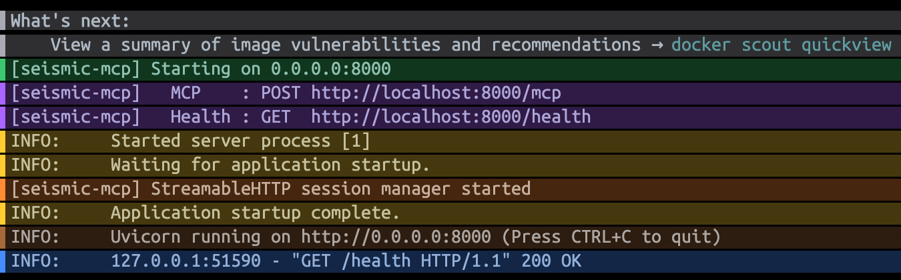

แถบสีบนภาพตรงกับสัญลักษณ์ในตารางคำอธิบาย

| สี | ข้อความใน log | ความหมาย |
|---|---|---|
| ⬜ | `What's next` และ `docker scout quickview` | ข้อความแนะนำของ Docker หลัง build เสร็จ ไม่เกี่ยวกับการทำงานของเซิร์ฟเวอร์ |
| 🟩 | `Starting on 0.0.0.0:8000` | เซิร์ฟเวอร์เริ่มทำงานที่พอร์ต 8000 ซึ่งเป็นข้อความที่สไลด์ p. 21 ใช้ยืนยันผล |
| 🟪 | `MCP : POST ...` และ `Health : GET ...` | ที่อยู่สำหรับเชื่อม MCP และตรวจสถานะเซิร์ฟเวอร์ |
| 🟨 | `Started server process`, `Waiting for application startup`, `Application startup complete` | ขั้นตอนการเปิดเว็บเซิร์ฟเวอร์จนพร้อมทำงาน |
| 🟧 | `StreamableHTTP session manager started` | ระบบ Streamable HTTP ของ MCP เริ่มทำงาน |
| 🟫 | `Uvicorn running on http://0.0.0.0:8000` | เว็บเซิร์ฟเวอร์ Uvicorn พร้อมรับคำขอ |
| 🟦 | `GET /health ... 200 OK` | Docker ตรวจแล้วว่าเซิร์ฟเวอร์ทำงานปกติ |

### ข้อมูลจาก TMD

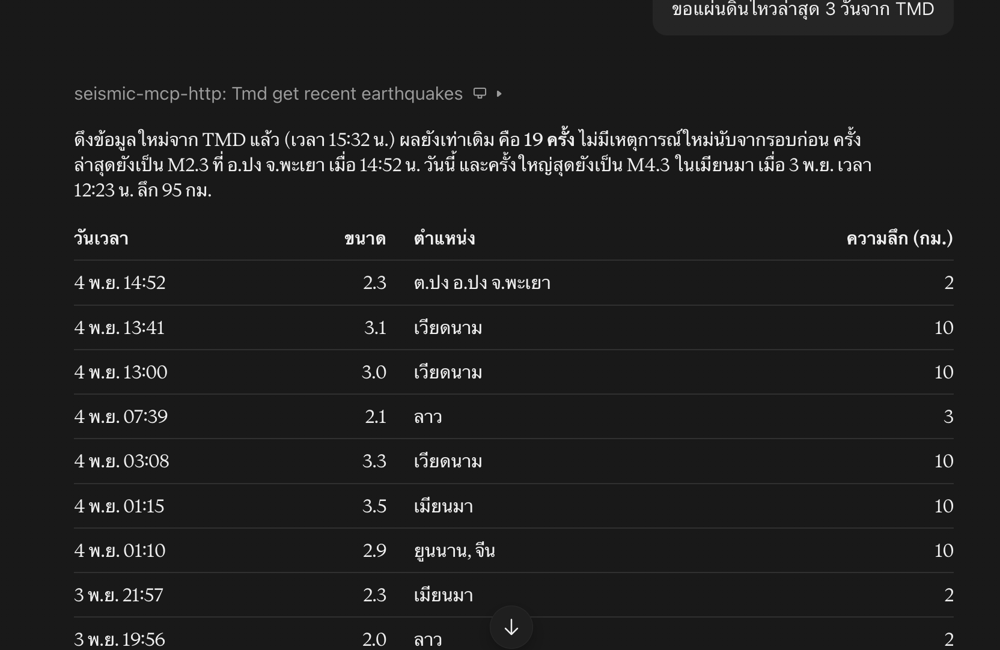

### ข้อมูลจาก USGS

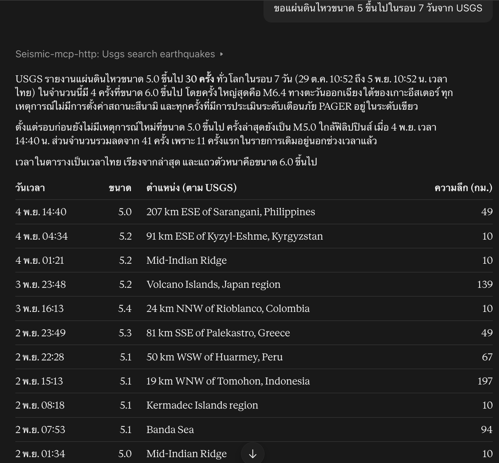

### Structured Error

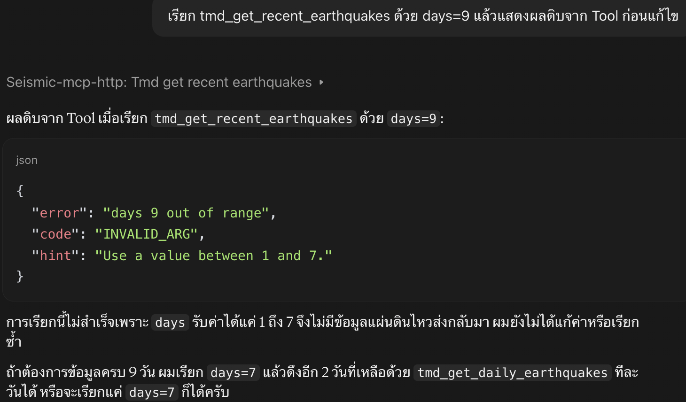

**ที่มาของการทดสอบ `days=9`**

`spec.md` หัวข้อ 6.3 `tmd_get_recent_earthquakes` กำหนดให้ `days` มีค่าเริ่มต้น 3 และรับค่าได้ตั้งแต่ 1 ถึง 7:

```json
"days": {
  "type": "integer",
  "description": "Number of days back from today (including today).",
  "default": 3,
  "minimum": 1,
  "maximum": 7
}
```

- ช่วง 1–7 มาจาก `spec.md`
- รูปแบบ `error`, `code`, `hint` มาจากชีทหัวข้อ Error Handling Strategy
- เลข 9 เป็นค่าทดสอบที่เลือกให้เกินค่าสูงสุด 7 ไม่ได้กำหนดไว้ใน `spec.md` หรือ Lab

### Log ของ Docker

แถบสีบนภาพตรงกับสัญลักษณ์ในตารางคำอธิบาย

| สี | ข้อความใน log | ความหมาย |
|---|---|---|
| 🟦 | `GET /health ... 200 OK` | Docker ตรวจว่าเซิร์ฟเวอร์ยังทำงานปกติ |
| 🟨 | `Processing request of type CallToolRequest` | เซิร์ฟเวอร์ได้รับคำสั่งให้ทำงานของ Tool จาก Claude |
| 🟩 | `HTTP Request: GET https://...` | เซิร์ฟเวอร์ส่งคำขอไปยังต้นทางข้อมูลแผ่นดินไหว และ API ตอบ `200 OK` |
| 🟪 | `POST /mcp ... 200 OK` | เซิร์ฟเวอร์ตอบผลกลับให้ Claude ผ่าน `mcp-remote` สำเร็จ |
| 🟧 | `Terminating session: None` | จบคำขอนั้น เพราะเซิร์ฟเวอร์ทำงานแบบ stateless |
| 🟥 | `CallToolRequest` ที่ไม่มีบรรทัด `HTTP Request` ตามมา | กรณี `days=9` ซึ่ง Tool ปฏิเสธค่าผิดก่อนเรียก API |

#### ขอข้อมูล TMD ย้อนหลัง 3 วัน

Claude เรียก Tool หนึ่งครั้ง เซิร์ฟเวอร์จึงส่งคำขอไป TMD 3 รอบ สำหรับวันที่ 5, 4 และ 3 พฤศจิกายน แล้วตอบผลกลับให้ Claude

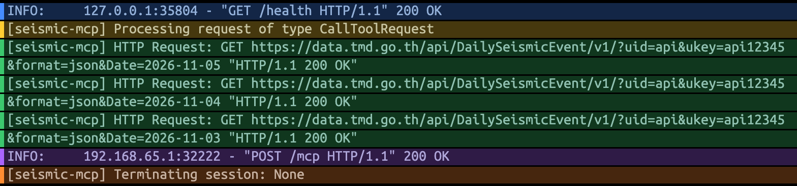

#### ขอข้อมูล USGS และทดสอบ days=9

ช่วงบนเป็นการส่งคำขอไป USGS ส่วนแถบสีแดงคือการทดสอบ `days=9` ซึ่งไม่มีการเรียก API ภายนอก

ค่า `%3A` ใน URL คือเครื่องหมาย `:` และเวลา `03:52` เป็นเวลา UTC ซึ่งตรงกับ 10:52 น. ตามเวลาไทย

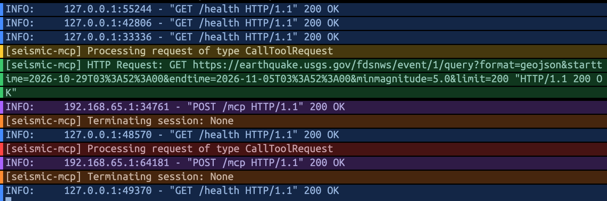

### การจับคู่ทรัพย์สิน

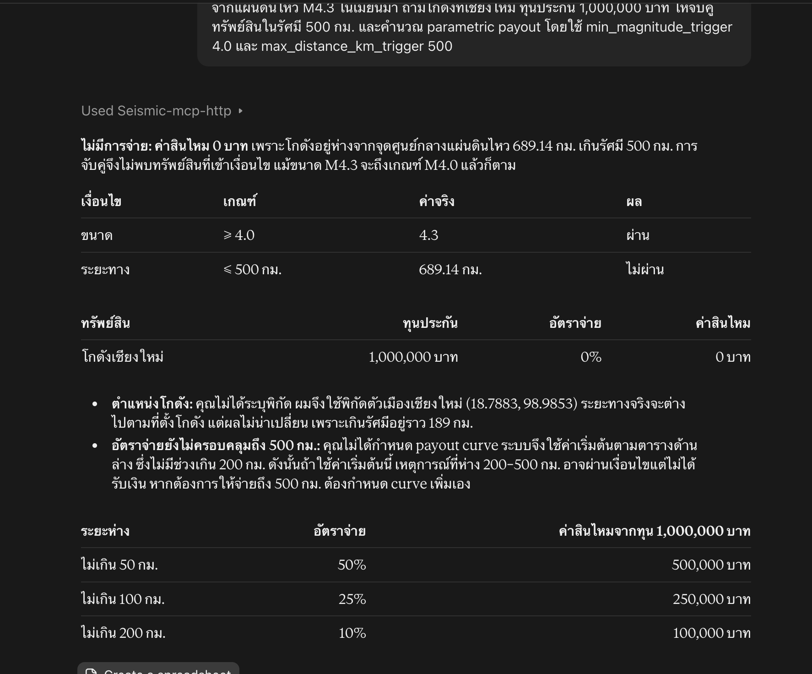

### การคำนวณ Payout

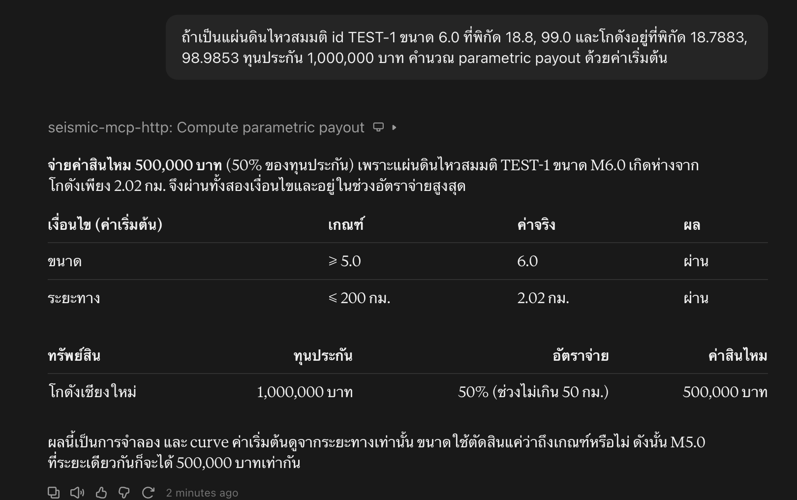

### Config ของ Claude Desktop

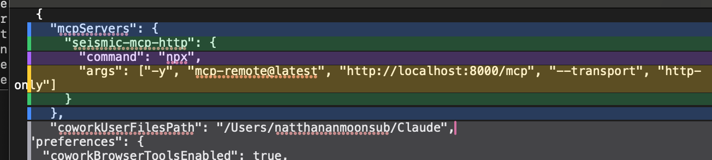

แถบสีบนภาพตรงกับสัญลักษณ์ในตารางคำอธิบาย

| สี | ส่วนใน config | ความหมาย |
|---|---|---|
| 🟦 | `mcpServers` | กลุ่มรายการ MCP Server ที่ Claude Desktop จะเชื่อมต่อ |
| 🟩 | `seismic-mcp-http` | ชื่อของ MCP Server ที่แสดงในแอปและในการเรียก Tool |
| 🟪 | `command` | คำสั่งที่ Claude Desktop ใช้เปิดตัวเชื่อม คือ `npx` |
| 🟨 | `args` | ค่าที่ส่งให้ `npx` เพื่อรัน `mcp-remote` เชื่อมไปที่ `http://localhost:8000/mcp` ด้วย transport แบบ `http-only` |
| ⬜ | `coworkUserFilesPath` และ `preferences` | การตั้งค่าอื่นของแอป ไม่เกี่ยวกับการเชื่อม MCP Server |

Claude Desktop เปิด `mcp-remote` ผ่าน `npx` แล้ว `mcp-remote` จะส่งต่อการเรียก Tool ไปยังเซิร์ฟเวอร์ใน Docker ที่พอร์ต 8000

## สื่อการสอนจากโค้ดจริง

ภาพชุดนี้สร้างจากโค้ดจริงในไฟล์ `seismic_mcp_server.py` ซึ่งแก้ docstring และ error handling ตามชีทแล้ว

### stdio กับ Streamable HTTP

`spec.md` หัวข้อ 2 และ 8 กำหนด transport แบบ stdio แต่สไลด์ Lab D p. 18 กำหนดให้ใช้ Streamable HTTP และรันบน Docker งานนี้จึงเปลี่ยนเฉพาะช่องทางสื่อสาร ส่วน Tool ทั้ง 5 ตัว input/output และ EarthquakeEvent ยังเป็นไปตาม spec

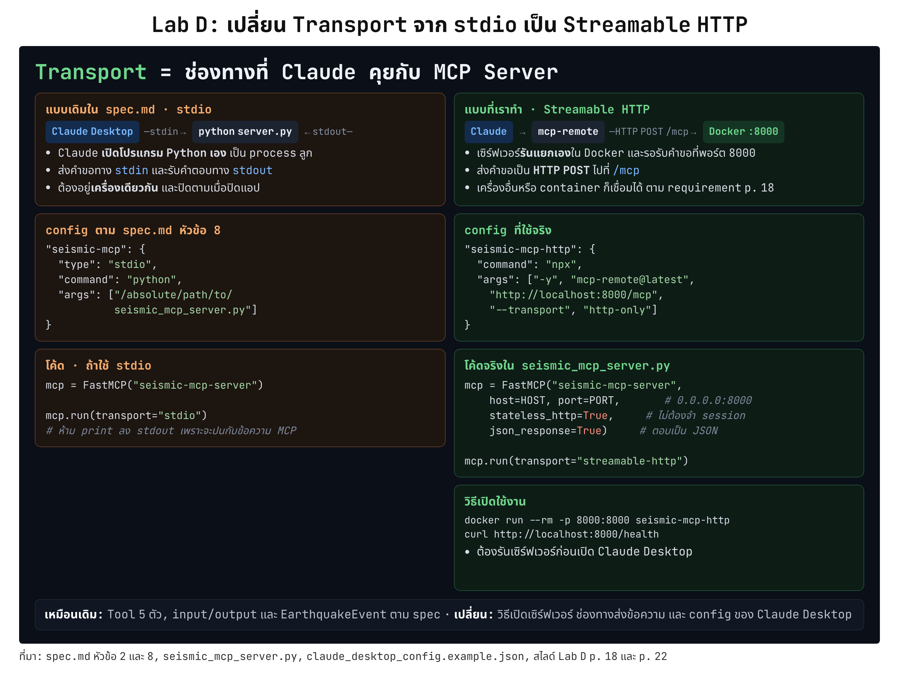

| | stdio (ตาม spec) | Streamable HTTP (งานนี้) |
|---|---|---|
| ผู้เปิดเซิร์ฟเวอร์ | Claude Desktop | รันเองใน Docker |
| ช่องทาง | `stdin` / `stdout` | HTTP POST ที่ `/mcp` |
| ตำแหน่งเซิร์ฟเวอร์ | เครื่องเดียวกันเท่านั้น | Docker หรือเครื่องอื่นได้ |
| ตรวจสถานะ | ผ่าน Claude เท่านั้น | `curl http://localhost:8000/health` |
| config | `"command": "python"` | `npx mcp-remote` ไปที่ `http://localhost:8000/mcp` |

#### คุยกันอย่างไร

stdio คือการคุยกันระหว่างโปรแกรมภายในเครื่องเดียวผ่าน `stdin` และ `stdout` ส่วน Streamable HTTP ส่งข้อความผ่านเครือข่ายตามที่อยู่และพอร์ต งานนี้ยังรันบน Mac เครื่องเดียว แต่ Claude ต้องส่งคำขอผ่าน `localhost:8000` เพื่อเข้า Docker container

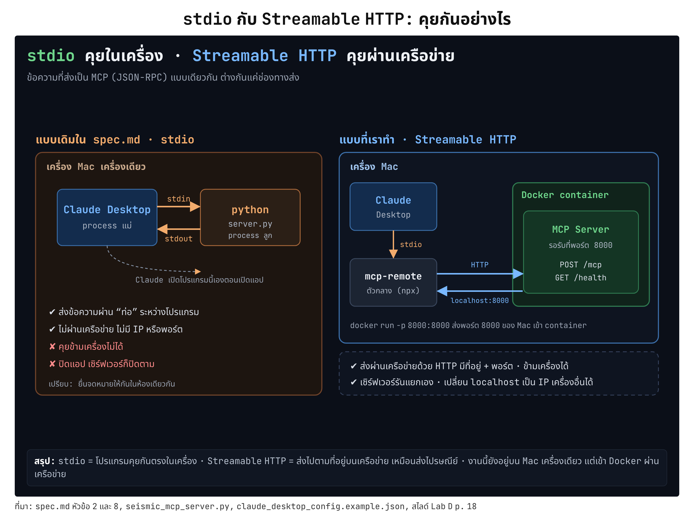

#### ตัวอย่างการคุยข้ามเครื่อง

เพราะเซิร์ฟเวอร์ตั้ง `HOST = 0.0.0.0` ถ้าเปลี่ยน `localhost` ใน config เป็น IP ของเครื่องที่รันเซิร์ฟเวอร์ Claude ก็เรียก Tool ข้ามเครื่องได้

> ภาพนี้เป็นตัวอย่างประกอบการเรียน ไม่ได้อยู่ใน requirement ของ Lab และยังไม่ได้ทดสอบข้ามเครื่องจริง IP ในภาพเป็นค่าสมมติ

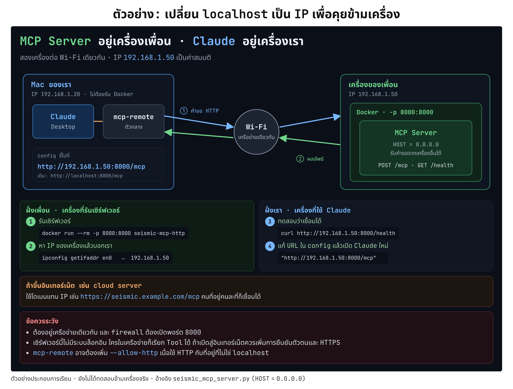

### Docker บน Mac

Container ต้องใช้ kernel ของ Linux เพราะ image สร้างจาก `python:3.11-slim` ซึ่งเป็น Debian Linux บน Mac จึงมี Docker Desktop เปิด Linux VM ขนาดเล็กไว้เบื้องหลัง แล้วรัน container ในนั้น ทุกชั้นใช้ CPU, RAM และดิสก์ของ Mac เครื่องเดียวกัน

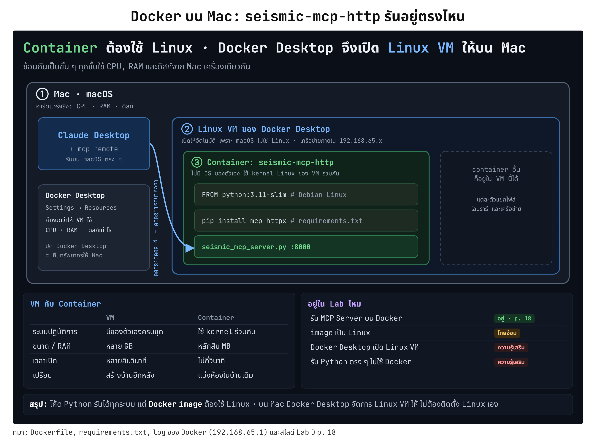

| | VM | Container |
|---|---|---|
| ระบบปฏิบัติการ | มีของตัวเองครบชุด | ใช้ kernel ร่วมกัน |
| ขนาด / RAM | หลาย GB | หลักสิบ MB |
| เวลาเปิด | หลายสิบวินาที | ไม่กี่วินาที |

> Lab D p. 18 กำหนดให้รันบน Docker ส่วนเรื่อง Linux VM เป็นความรู้เสริมที่อธิบายว่าทำไมรันบน Mac ได้ ตัวโค้ด `seismic_mcp_server.py` รันได้ทุกระบบที่มี Python 3.10 ขึ้นไป

### @mcp.tool()

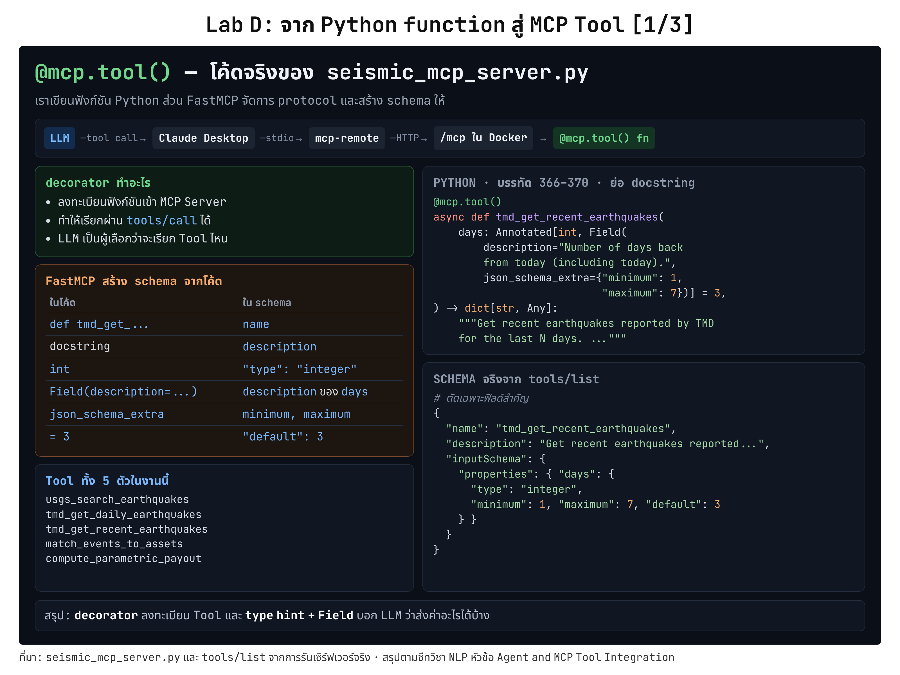

### Docstring

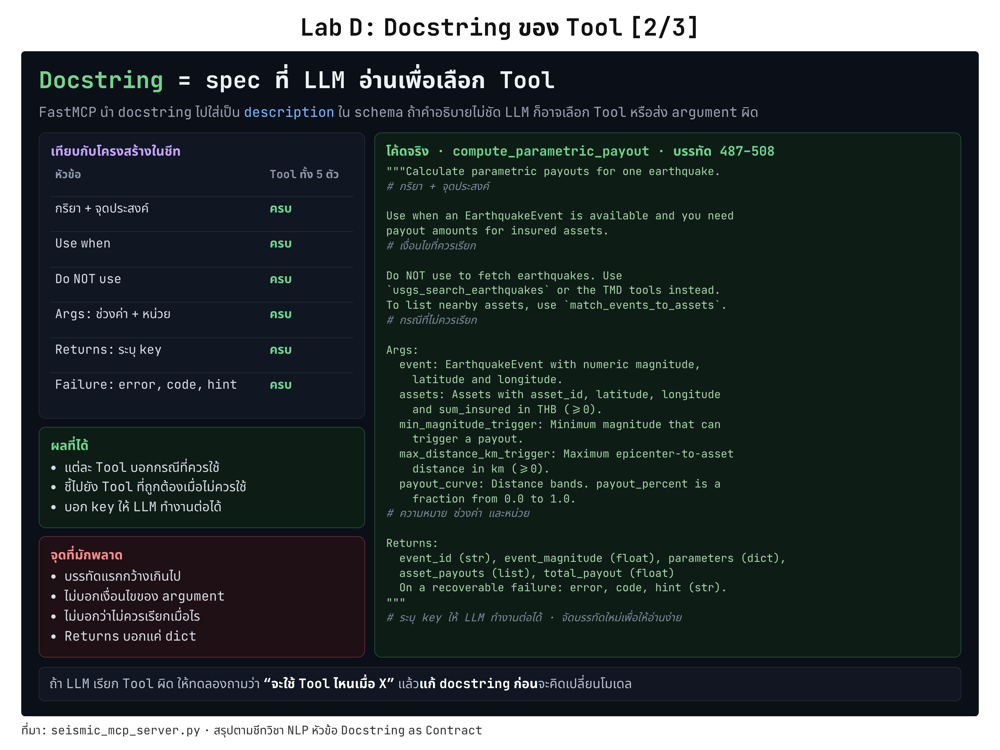

### Error Handling

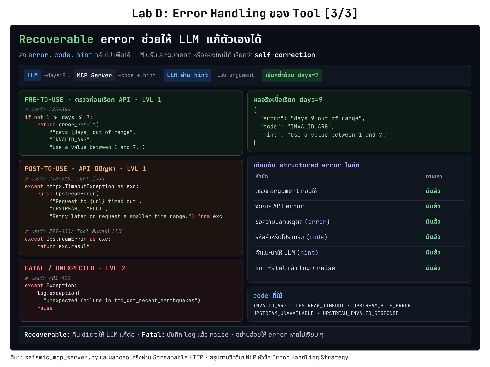

## ปัญหาที่พบและวิธีแก้

| ปัญหา | สาเหตุ | วิธีแก้ |
|---|---|---|
| หน้า Connectors ในสไลด์ p. 10 ไม่ตรงกับแอป | เมนูของ Claude Desktop เวอร์ชันปัจจุบันเปลี่ยนไป | ใช้เมนูในแอปเวอร์ชันปัจจุบันเพื่อเปิดใช้ Filesystem แล้วตรวจ allowed directory |
| `No module named 'mcp.server.fastmcp'` | แพ็กเกจ `mcp` 2.x เปลี่ยน API | ล็อกเวอร์ชันเป็น `mcp==1.30.0` |
| `can't open file ... Permission denied` | ไฟล์มีสิทธิ์ `600` และ container รันด้วย `appuser` | เพิ่ม `RUN chmod 644 seismic_mcp_server.py` ใน `Dockerfile` |
| หาเมนู Developer ไม่เจอ | หน้า Settings ไม่ตรงกับที่คาดไว้ | เปิด `claude_desktop_config.json` ด้วยคำสั่ง `open -e` |
| JSON ใน config ผิดรูปแบบ | จุลภาคผิดตำแหน่ง | แก้จุลภาคแล้วตรวจด้วย `python3 -m json.tool` |
| `seismic-mcp-http couldn't start` และ `ReferenceError: File is not defined` | Node.js 18 เก่าเกินไปสำหรับ `mcp-remote` | อัปเดต Node.js เป็น v26.13.0 |
| คำตอบในแชตมาจากเซิร์ฟเวอร์ตัวเก่า | มี `seismic-mcp` เดิมอยู่ใน config และชื่อ Tool ซ้ำกัน | ลบตัวเดิมออก แล้วตรวจหัวข้อ `seismic-mcp-http` และ log `CallToolRequest` |
| error ด้านช่วงค่าไม่มี `code` และ `hint` | `Field(ge=..., le=...)` ทำให้ pydantic ตัดคำขอก่อนเข้า Tool | บอกช่วงค่าใน `json_schema_extra` แล้วตรวจในฟังก์ชัน |
| TMD คืนค่าว่าง | API จริงใช้ `DailyEarthquakes`, ไม่มี `EventID` และไม่กรองตาม `Date` | รองรับโครงสร้างจริง สร้าง ID จากเวลาและพิกัด และกรองวันที่ในเซิร์ฟเวอร์ |

## ความแตกต่างจาก spec

- ใช้ Streamable HTTP แทน stdio ตาม requirement ของ Lab D
- ใช้ `FastMCP` จากแพ็กเกจ `mcp`
- ข้อผิดพลาดที่แก้ต่อได้จะตอบเป็น `error`, `code`, `hint` ตามชีท แทน JSON-RPC error
- ข้อผิดพลาดที่ไม่คาดคิดจะบันทึก log แล้ว raise
- Docstring ของ Tool เพิ่ม Use when, Do NOT use, Args และ Returns ตามชีท
- อ่าน TMD ได้ทั้งโครงสร้างใน spec และโครงสร้างจาก API จริง

## ทดสอบโค้ด

```bash
pip install -r requirements.txt pytest
pytest -q
```

## แหล่งข้อมูล

- [USGS Earthquake FDSN API](https://earthquake.usgs.gov/fdsnws/event/1/)
- [Thai Meteorological Department Open Data](https://data.tmd.go.th/)
- สไลด์วิชา Natural Language Processing โดย Mr. Aekanun Thongtae
