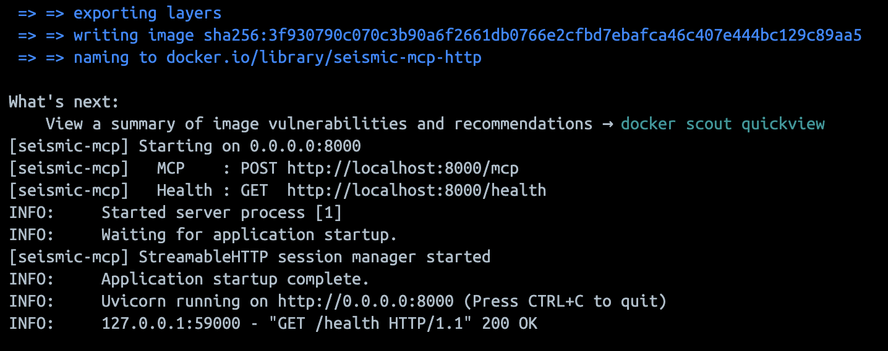
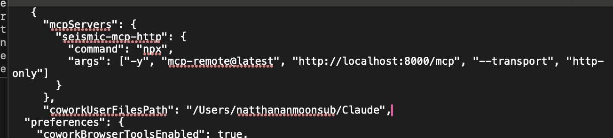

# Seismic & Insurance Analytics MCP Server

งานวิชา Natural Language Processing หัวข้อ Agent and MCP Tool Integration (Lab C และ Lab D)

MCP Server สำหรับดึงข้อมูลแผ่นดินไหวจาก USGS และกรมอุตุนิยมวิทยา (TMD) แล้วให้ Agent ใช้ค้นหา วิเคราะห์ และคำนวณ parametric payout ของทรัพย์สินที่เอาประกัน

- Transport: Streamable HTTP
- Runtime: Docker container
- MCP Host: Claude Desktop เชื่อมผ่าน `mcp-remote`
- Endpoint: `http://localhost:8000/mcp`

## สถานะงาน

| งาน | รายการ | ผล |
|---|---|---|
| Lab C | ติดตั้ง Claude Desktop | เสร็จ |
| Lab C | ติดตั้ง Filesystem และกำหนด allowed directory | เสร็จ |
| Lab D | ดึงข้อมูลจาก USGS และ TMD | เสร็จ |
| Lab D | Tool วิเคราะห์และคำนวณ payout | เสร็จ |
| Lab D | Transport แบบ Streamable HTTP | เสร็จ |
| Lab D | รันบน Docker | เสร็จ |
| Lab D | เชื่อม Claude Desktop กับ MCP Server | เสร็จ |

## โครงสร้างโปรเจกต์

```text
.
├── seismic_mcp_server.py                MCP Server และ Tool ทั้ง 5 ตัว
├── test_server.py                       Unit test
├── requirements.txt                     Python dependencies
├── Dockerfile                           ไฟล์ build Docker image
├── claude_desktop_config.example.json   ตัวอย่าง config ของ Claude Desktop
└── docs/images/                         ภาพผลการทดสอบ
```

## Tools

| Tool | หน้าที่ |
|---|---|
| `usgs_search_earthquakes` | ค้นหาแผ่นดินไหวจาก USGS |
| `tmd_get_daily_earthquakes` | ดึงข้อมูลรายวันจาก TMD |
| `tmd_get_recent_earthquakes` | ดึงข้อมูลย้อนหลัง 1–7 วันจาก TMD |
| `match_events_to_assets` | จับคู่แผ่นดินไหวกับทรัพย์สินตามระยะทางและขนาด |
| `compute_parametric_payout` | คำนวณ parametric payout |

ค่าเริ่มต้นของ payout: ไม่เกิน 50 กม. จ่าย 50%, ไม่เกิน 100 กม. จ่าย 25%, ไม่เกิน 200 กม. จ่าย 10% และแผ่นดินไหวต้องมีขนาดอย่างน้อย 5.0

## วิธีติดตั้งและรัน

สิ่งที่ต้องมี: Docker Desktop, Claude Desktop และ Node.js 20 ขึ้นไป

### 1. Build และรัน MCP Server

```bash
git clone <URL ของ repository นี้>
cd <ชื่อโฟลเดอร์ของ repository>
docker build -t seismic-mcp-http .
docker run --rm -p 8000:8000 seismic-mcp-http
```

ถ้าทำงานถูกต้องจะเห็นข้อความ `Starting on 0.0.0.0:8000`

ทดสอบจาก Terminal อีกหน้าต่าง:

```bash
curl http://localhost:8000/health
```

### 2. เชื่อมกับ Claude Desktop

เปิดไฟล์ config:

```bash
open -e ~/Library/Application\ Support/Claude/claude_desktop_config.json
```

เพิ่มค่านี้ใน `mcpServers` โดยคงคีย์อื่นในไฟล์ไว้:

```json
"seismic-mcp-http": {
  "command": "npx",
  "args": ["-y", "mcp-remote@latest", "http://localhost:8000/mcp", "--transport", "http-only"]
}
```

ตรวจรูปแบบ JSON:

```bash
python3 -m json.tool ~/Library/Application\ Support/Claude/claude_desktop_config.json > /dev/null && echo OK
```

จากนั้นกด Cmd+Q ที่ Claude Desktop แล้วเปิดใหม่

### 3. ทดสอบ

ตัวอย่างคำถามในแชตใหม่:

- ขอแผ่นดินไหวขนาด 5 ขึ้นไปในรอบ 7 วันจาก USGS
- ขอแผ่นดินไหวล่าสุด 3 วันจาก TMD

หัวข้อการเรียกเครื่องมือในแชตต้องขึ้นว่า `seismic-mcp-http`

## การรันเซิร์ฟเวอร์ครั้งถัดไป

เซิร์ฟเวอร์ทำงานเฉพาะตอน Docker container รันอยู่ ถ้าปิดไป ให้เปิด Docker Desktop แล้วรันใหม่:

```bash
docker run --rm -p 8000:8000 seismic-mcp-http
```

ถ้าแก้โค้ด ต้อง build ใหม่ก่อน:

```bash
docker build -t seismic-mcp-http .
docker run --rm -p 8000:8000 seismic-mcp-http
```

ต้องการหยุดเซิร์ฟเวอร์ ให้กด Ctrl+C ในหน้าต่างที่รันอยู่

## ผลลัพธ์

ทดสอบเมื่อ 4 พฤศจิกายน 2026 บน macOS ผลด้านล่างอาจเปลี่ยนตามข้อมูลล่าสุดของ API

| การทดสอบ | ผล |
|---|---|
| Unit test | ผ่าน 10 ข้อ |
| Docker | เซิร์ฟเวอร์เริ่มที่ `0.0.0.0:8000` |
| USGS ผ่าน `seismic-mcp-http` | ได้ข้อมูลจริง |
| TMD ย้อนหลัง 3 วัน | ได้ข้อมูลจริง 19 เหตุการณ์ |
| จับคู่ทรัพย์สินที่ห่าง 689.14 กม. เกินรัศมี 500 กม. | ไม่เข้าเงื่อนไข ค่าสินไหม 0 บาท |
| Payout กรณีสมมติ M6.0 ห่าง 2.02 กม. ทุน 1,000,000 บาท | จ่าย 50% เป็นเงิน 500,000 บาท |

### MCP Server รันบน Docker



### ข้อมูลจาก TMD


### การจับคู่ทรัพย์สิน


### การคำนวณ Payout


### Config ของ Claude Desktop



## ปัญหาที่พบและวิธีแก้

| ปัญหา | สาเหตุ | วิธีแก้ |
|---|---|---|
| หน้า Connectors ในสไลด์ p. 10 ไม่ตรงกับแอป | เมนูของ Claude Desktop เวอร์ชันปัจจุบันเปลี่ยนไป | ใช้เมนูในแอปเวอร์ชันปัจจุบันเพื่อเปิดใช้ Filesystem แล้วตรวจ allowed directory |
| `No module named 'mcp.server.fastmcp'` | แพ็กเกจ `mcp` 2.x เปลี่ยน API | ล็อกเวอร์ชันเป็น `mcp==1.30.0` |
| `can't open file ... Permission denied` | ไฟล์มีสิทธิ์ `600` และ container รันด้วย `appuser` | เพิ่ม `RUN chmod 644 seismic_mcp_server.py` ใน `Dockerfile` |
| หาเมนู Developer ไม่เจอ | หน้า Settings ไม่ตรงกับที่คาดไว้ | เปิด `claude_desktop_config.json` ด้วยคำสั่ง `open -e` |
| JSON ใน config ผิดรูปแบบ | จุลภาคผิดตำแหน่ง | แก้จุลภาคแล้วตรวจด้วย `python3 -m json.tool` |
| `seismic-mcp-http couldn't start` และ `ReferenceError: File is not defined` | Node.js 18 เก่าเกินไปสำหรับ `mcp-remote` | อัปเดต Node.js เป็น v26.13.0 |
| คำตอบในแชตมาจากเซิร์ฟเวอร์ตัวเก่า | มี `seismic-mcp` เดิมอยู่ใน config และชื่อ Tool ซ้ำกัน | ลบตัวเดิมออก แล้วตรวจหัวข้อ `seismic-mcp-http` และ log `CallToolRequest` |
| TMD คืนค่าว่าง | API จริงใช้ `DailyEarthquakes`, ไม่มี `EventID` และไม่กรองตาม `Date` | รองรับโครงสร้างจริง สร้าง ID จากเวลาและพิกัด และกรองวันที่ในเซิร์ฟเวอร์ |

## ความแตกต่างจาก spec

- ใช้ Streamable HTTP แทน stdio ตาม requirement ของ Lab D
- ใช้ `FastMCP` จากแพ็กเกจ `mcp`
- เมื่อ Tool เกิดข้อผิดพลาด จะตอบเป็นผลลัพธ์ที่มี `isError: true`
- อ่าน TMD ได้ทั้งโครงสร้างใน spec และโครงสร้างจาก API จริง

## ทดสอบโค้ด

```bash
pip install -r requirements.txt pytest
pytest -q
```

## แหล่งข้อมูล

- [USGS Earthquake FDSN API](https://earthquake.usgs.gov/fdsnws/event/1/)
- [Thai Meteorological Department Open Data](https://data.tmd.go.th/)
- สไลด์วิชา Natural Language Processing โดย Mr. Aekanun Thongtae
